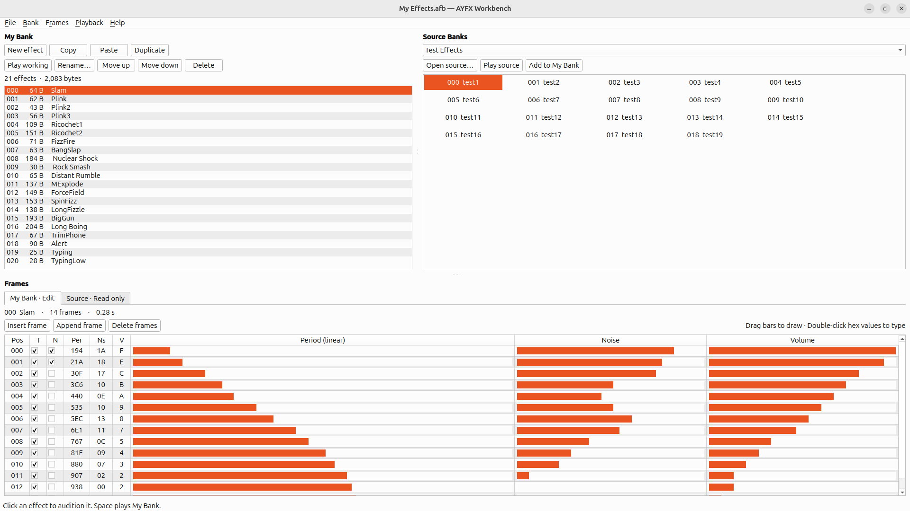

# AYFX Workbench

A Python and Qt desktop editor for auditioning, assembling, and editing Shiru AYFX sound-effect banks (`.afb`) for projects such as Spectrum Next games.

**Licence** · [MIT](LICENSE)

## What it does

- Audition effects from bundled or external source banks and drag them into **My Bank**.
- Rename, reorder, duplicate, and edit effects with undo and redo.
- Edit individual AY frames or draw tone, noise, and volume curves across multiple frames.
- Save a standard AFB and see its exact byte count before writing the file.



## Install on Ubuntu

Use Python 3.10 or later. The pinned PySide6 wheel requires glibc 2.34 or later on x86-64. Ubuntu 22.04 or later meets those requirements on x86-64.

Open a terminal in the repository or extracted release folder. Install the Ubuntu venv package if needed, then create the environment and launch the app.

```bash
sudo apt install python3-venv
python3 -m venv .venv
source .venv/bin/activate
python -m pip install -r requirements.txt
python app.py
```

The app uses the desktop's default audio device. If Qt reports an XCB platform plugin error mentioning libxcb-cursor, install `libxcb-cursor0`. In VS Code, select `.venv/bin/python` as the interpreter and run `app.py`.

## Command line

```bash
python app.py --help
python app.py -h
python app.py '-?'
python app.py --bank "/path/to/My Effects.afb" --samples "/path/to/Source Banks" --maximised
```

| Switch | Behaviour |
|---|---|
| `--bank FILE` | Open an AFB in My Bank at startup. |
| `--samples DIR` | Use this directory and its subdirectories for the source-bank selector. The default is the bundled `samples/` directory. |
| `--maximised`, `--maximized` | Open the app in a maximised window. |
| `-h`, `-?`, `--help` | Print usage and exit successfully. Quote `'-?'` in a shell to prevent wildcard expansion. |

Invalid syntax prints the help and an error to stderr, then exits with status 2.

## Use the Workbench

1. Pick a **Source Banks** collection and click an effect to hear it.
2. Drag the effect into **My Bank** at the position you want, or click **Add to My Bank** to append it.
3. Select the working effect and edit its frames. Drag through the bar columns to draw values, or double-click a hex value to type it. **Ctrl+Z** undoes an edit.
4. Press **Space** or right-click in the working frame grid to audition the result. Use **File → Save bank as…** to write your AFB.

Press **F1** or open **Help → Using AYFX Workbench** for the full [usage guide](docs/USAGE.md). See [Internals](docs/INTERNALS.md) for the code, AFB format, and release procedure.

## Credits and sample banks

- [Shiru](https://shiru.untergrund.net/software.shtml) created the AYFX editor and format.
- [Remy Sharp’s ZX Tools audio editor](https://zx.remysharp.com/audio/) is the original web editor. The Workbench’s audition renderer is adapted from [zx-tools](https://github.com/remy/zx-tools). Its original licence is in [REMY-MIT.txt](REMY-MIT.txt).
- [NexySFX Studio by Kilabyte Software](https://kilabytesoftware.itch.io/nexysfx-studio) documented the enhanced AFB metadata that the Workbench recognises on import.

The four included sample banks come from Remy Sharp’s [zx-tools sample assets](https://github.com/remy/zx-tools/tree/26e8286e032f3164f5225fbb5d3a894a008b289e/public/static/assets). They are listed separately from the Workbench’s code licence.

| Source Bank | Included file |
|---|---|
| Test Effects | `samples/tests.afb` |
| ZX Games | `samples/zxgames.afb` |
| ZX MSX Demos | `samples/zxmsx.afb` |
| Streets of Rage 2 | `samples/streets.afb` |
